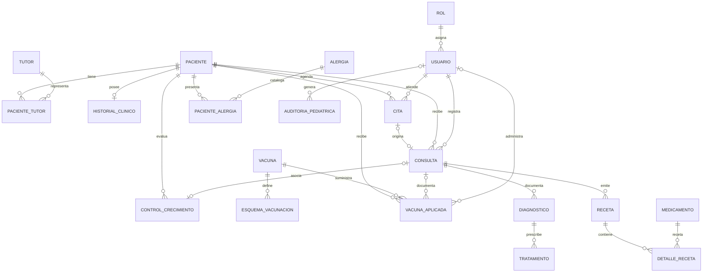

# Modelo Relacional Corregido · Centro Pediátrico (I4-04 / I4-05)

**Estado:** Propuesta formal para el motor MariaDB (local y MariaDB Cloud).
**Responsable:** I4 · Centro Pediátrico.
**Fuentes y referencias:** `docs/planificacion/PLANIFICACION.md` (Secciones 3.4 y 7.3), `contratos/API.md`, `AGENTS.md` y ADR `docs/decisiones/0001-trigger-tutor-principal-mariadb.md`.

---

## 1. Diagrama Entidad-Relación (Mermaid)



---

## 2. Verificación Estricta del Checklist 7.3 (`PLANIFICACION.md`)

| Requisito Checklist 7.3 | Solución implementada en MariaDB | Estado |
|---|---|:---:|
| `esquema_vacunacion` renombrada a `vacuna_aplicada` con `UNIQUE (id_paciente, id_vacuna, numero_dosis)` y opcionalmente `id_consulta` o `id_usuario`. | Tabla `vacuna_aplicada` con `CONSTRAINT uq_vacuna_aplicada_paciente_dosis UNIQUE (id_paciente, id_vacuna, numero_dosis)` y FKs opcionales a `consulta` y `usuario`. | Cumplido |
| Nueva tabla `esquema_vacunacion` real con `id_vacuna`, `numero_dosis` y `edad_recomendada_meses`. | Tabla `esquema_vacunacion` separada con catálogo oficial de inmunizaciones por edad y dosis recomendada. | Cumplido |
| `control_crecimiento` con `UNIQUE (id_consulta)` y `CHECK` de rangos positivos. | Tabla `control_crecimiento` con `id_consulta INT UNIQUE NULL` y `ck_control_rangos_positivos (peso > 0, talla > 0, edad >= 0, etc.)`. | Cumplido |
| Tutor principal único mediante trigger documentado en ADR. | Triggers `trg_paciente_tutor_principal_bi` y `trg_paciente_tutor_principal_bu` sobre `paciente_tutor` y ADR `docs/decisiones/0001-trigger-tutor-principal-mariadb.md`. | Cumplido |
| `nivel_severidad` con `CHECK` o catálogo en `paciente_alergia`. | `CONSTRAINT ck_paciente_alergia_severidad CHECK (nivel_severidad IN ('leve', 'moderada', 'severa', 'anafilaxia'))`. | Cumplido |
| Decisiones comunes de la sección 3.4. | Tratamiento depende de diagnóstico, consulta y cita vinculadas por FK compuesta `(id_cita, id_paciente)`, archivo solo en `historial_clinico`, correo único, no doble reserva en cita con `UNIQUE (id_usuario, fecha, hora)`. | Cumplido |
| Diagrama reacomodado para que `alergia -> paciente_alergia` no parezca llegar a otra tabla. | Relación limpia `ALERGIA ||--o{ PACIENTE_ALERGIA` y `PACIENTE ||--o{ PACIENTE_ALERGIA`. | Cumplido |

---

## 3. Decisiones de Modelado Comunes (Sección 3.4)

1. **Tratamiento depende de Diagnóstico (3.4 #1):**
   La tabla `tratamiento` tiene FK `fk_tratamiento_diagnostico` que referencia a `diagnostico(id_diagnostico)`. No existen tratamientos huérfanos ni vinculados directamente a la consulta.
2. **Consulta y Cita del mismo paciente (3.4 #2):**
   La tabla `cita` posee `UNIQUE (id_cita, id_paciente)` y la tabla `consulta` posee la clave foránea compuesta:
   ```sql
   CONSTRAINT fk_consulta_cita_paciente
     FOREIGN KEY (id_cita, id_paciente)
     REFERENCES cita (id_cita, id_paciente) ON DELETE RESTRICT
   ```
   Esto imposibilita a nivel de base de datos registrar una consulta asignándole una cita agendada para otro menor.
3. **Fuente única de verdad para el estado de archivo (3.4 #3 y Regla #2 LSP):**
   Se eliminó cualquier columna de estado o baja en la tabla `paciente`. El estado clínico y de archivo vive **exclusivamente** en `historial_clinico.estado` (`'activo' | 'archivado'`), acompañado de `fecha_archivo`, `motivo_archivo_tipo` y `motivo_archivo_detalle`.
4. **No duplicidad en agenda médica (3.4 #7):**
   Se incluye `CONSTRAINT uq_cita_usuario_fecha_hora UNIQUE (id_usuario, fecha, hora)` para evitar que un mismo pediatra sea reservado dos veces en el mismo instante.
5. **Identificadores y Tipos:**
   Todas las tablas relacionales usan `INT AUTO_INCREMENT PRIMARY KEY`. El Data Mapper (`src/infrastructure/adapters/mariadb/mapper.js`) se encarga de traducirlos a `string` para cumplir con el contrato de la API.

---

## 4. Estructura de Tablas (20 tablas)

1. `rol`: catálogo de perfiles del centro (`pediatra`, `enfermeria`, `recepcion`).
2. `usuario`: profesionales de la salud y personal administrativo.
3. `paciente`: menores de edad (datos demográficos básicos).
4. `tutor`: padres, tutores legales y personas responsables con DPI y contacto.
5. `paciente_tutor`: relación muchos-a-muchos con parentesco y validación de tutor principal único.
6. `historial_clinico`: expediente médico formal y control de archivo justificado.
7. `cita`: agenda de atenciones ambulatorias pediátricas.
8. `consulta`: encuentro clínico entre el pediatra y el menor.
9. `control_crecimiento`: métricas antropométricas (peso, talla, perímetro cefálico, IMC, percentil OMS).
10. `vacuna`: catálogo de biológicos disponibles.
11. `esquema_vacunacion`: pauta oficial de dosis y edad recomendada en meses.
12. `vacuna_aplicada`: registro de aplicación de biológico con lote y reacción adversa.
13. `alergia`: catálogo de alérgenos comunes en pediatría.
14. `paciente_alergia`: registro de alérgenos diagnosticados por menor y nivel de severidad.
15. `diagnostico`: conclusiones clínicas de la consulta con código CIE-10 opcional.
16. `tratamiento`: planes terapéuticos asociados al diagnóstico.
17. `receta`: prescripción médica de la consulta con peso de referencia.
18. `medicamento`: vademécum de formulaciones y presentaciones pediátricas.
19. `detalle_receta`: posología, dosis calculada, frecuencia y duración por medicamento.
20. `auditoria_pediatrica`: trazabilidad de modificaciones críticas en formato JSON.
