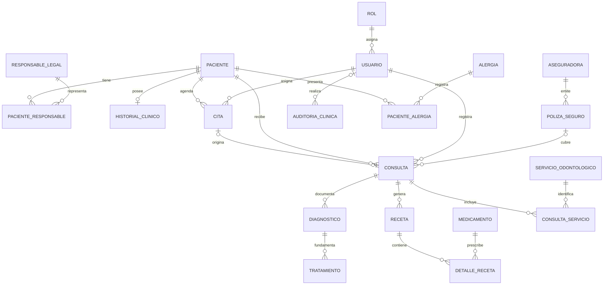

# Modelo relacional propuesto · Odontología (I2-04 / I2-05)

**Estado:** propuesta para revisión del equipo. El DDL no se ejecutó en Supabase y no es una migración para una base con datos.

## Fuentes comparadas

- `adonto version 2.pdf` y `codigo de referencia odonto .sql`: modelo original con 18 tablas.
- `docs/borradores/I2-05/odontologia_I2-05_borrador_revision.sql` y `odontologia_revision_modelo_v2.md`: borrador revisado conservado sin cambios.
- `contratos/API.md` y `docs/planificacion/PLANIFICACION.md`, especialmente secciones 3.4 y 7.2.

El contrato publicado define la forma común (`id` string, camelCase, fechas ISO, `detallesInstitucion`) y el estado de archivo `activo | archivado`. Los directorios de entidades Zod y validadores HTTP aún no contienen esquemas con estados odontológicos. Por tanto, los estados de cita, consulta y tratamiento del borrador no pueden considerarse aprobados por el contrato actual.

## Validación local reportada

El equipo ejecutó el script en PostgreSQL 16 local. Resultados comunicados:

| Comprobación | Resultado |
|---|---:|
| Tablas creadas | 20 |
| Claves foráneas | 21 |
| Columnas identity | 18 |
| Restricciones `CHECK` | 15 |
| Tablas con RLS habilitado | 20 |
| Índices explícitos | 17 |
| Pruebas de integridad | 15/15 exitosas |

Las 15 pruebas se reportaron en cuatro rondas (4/4, 4/4, 4/4 y 3/3). Todas finalizaron con `ROLLBACK`. No se ejecutó SQL en Supabase. Esta verificación prueba creación e integridad en local, pero no concede aprobación a las reglas funcionales pendientes ni valida políticas RLS con un rol real de aplicación.

## Resultado relacional propuesto

Se conservan las 18 tablas del SQL original y se añaden `aseguradora` y `poliza_seguro`, requeridas por el checklist 7.2 y no presentes en los documentos originales: **20 tablas**. La relación de seguro queda conectada a `consulta.id_poliza` nullable. Se propone que el equipo confirme si una póliza pertenece a una persona o puede cubrir a varios pacientes; el DDL actual no atribuye la póliza a un paciente.

Las relaciones de núcleo conservadas son:

- `usuario` → `rol`; `cita` y `consulta` → `usuario` y `paciente`.
- `consulta` → `cita` mediante FK compuesta `(id_cita, id_paciente)` y `cita` tiene `UNIQUE (id_cita, id_paciente)`. `id_cita` permanece nullable y único para admitir consultas sin cita y limitar a una consulta por cita.
- `diagnostico` → `consulta`; `tratamiento` → `diagnostico`; `receta` → `consulta`; `detalle_receta` → `receta` y `medicamento`.
- `consulta_servicio` → `consulta` y `servicio_odontologico`; `paciente_alergia` → paciente y alergia; `historial_clinico` → paciente.
- `paciente_responsable` conserva su PK compuesta. Un índice único parcial permite como máximo un responsable principal por paciente; que menores deban tenerlo sigue siendo validación de aplicación.

La FK compuesta `(consulta.id_cita, consulta.id_paciente)` es intencional: evita enlazar una cita de otro paciente. La relación póliza-consulta no valida todavía que la póliza corresponda al paciente; la política puede ser individual o familiar y requiere decisión clínica/administrativa.

## Diferencias y correcciones respecto al SQL original y al borrador

1. Todas las PK identity pasan a `integer GENERATED ALWAYS AS IDENTITY`, como pide el checklist de PostgreSQL.
2. Los campos con hora (`fecha_creacion`, consulta, auditoría, receta, actualización/finalización y archivo) usan `timestamptz`. La cita mantiene `date` + `time without time zone` hasta que el equipo defina zona horaria y contrato.
3. La fuente de verdad del archivo es `historial_clinico.estado`, con `activo | archivado`. Se quita `paciente.estado` para no duplicar el estado de archivo. El motivo se separa en tipo y detalle y se valida junto con `fecha_archivo`.
4. Se añaden los CHECK de estado propuestos, fechas de tratamiento/consulta, cantidad positiva, importes no negativos y cobertura/fechas de póliza. Las listas de estados siguen pendientes de aprobación y sincronización futura con Zod; no se modificó ningún contrato compartido.
5. Se añade `UNIQUE (id_usuario, fecha, hora)` a cita según la decisión común de 3.4. Tal como está definido, también reserva el horario de citas canceladas; confirmar si se permite reusar esos espacios.
6. El borrador añadía `consulta_servicio_pieza` y admitía FDI permanente y temporal (11–48 y 51–85), con superficie obligatoria. El checklist 7.2 especifica `consulta_servicio.pieza_dental` (FDI 11–48) y superficie opcional. El DDL sigue el checklist con columnas opcionales en `consulta_servicio`, sin tabla adicional. Confirmar con odontología si se necesita dentición temporal, varias piezas/superficies por servicio y un catálogo clínico de superficies.
7. El borrador carecía de las tablas de aseguradora/póliza del checklist. El DDL agrega ambas con `UNIQUE (id_aseguradora, numero_poliza)`, cobertura entre 0 y 100, fechas válidas y `consulta.id_poliza` nullable.
8. Se agregan índices de FKs y búsquedas, además del índice parcial para responsable principal. Se preserva `ON DELETE RESTRICT` para datos clínicos.
9. Se activa RLS sin políticas: el acceso queda denegado por defecto para roles sujetos a RLS. Los roles mínimos y políticas utilizables deben diseñarse/aprobarse en I2-08; no exponer estas tablas por PostgREST antes de esa tarea.

## Decisiones que requieren aprobación

- Confirmar las entidades y campos de seguro añadidos, si las pólizas pueden ser compartidas y si una consulta debe impedir usar una póliza de otro paciente.
- Aprobar los valores exactos de `cita.estado`, `consulta.estado` y `tratamiento.estado`; el contrato actual no los define.
- Citas canceladas: el `UNIQUE (id_usuario, fecha, hora)` actual mantiene el horario reservado aunque la cita quede cancelada. Aprobar si ese comportamiento es intencional o si una cancelación debe liberar el espacio. El constraint también bloquea solo coincidencias exactas de fecha y hora; no calcula solapamientos por duración.
- Piezas dentales: el DDL admite una sola pieza FDI permanente (11–48) y una superficie opcional por fila de `consulta_servicio`. Para varios dientes/superficies se necesitarían varias filas; aprobar si representa el flujo clínico y si se requieren piezas temporales. Las superficies aceptadas (`O`, `M`, `D`, `V`, `L`, `P`, `I`) se validan como catálogo general, no según la anatomía específica de cada diente.
- Definir zona horaria de cita y semántica de `id_usuario` (odontólogo o registrador).
- Confirmar el vocabulario de `paciente_alergia.nivel_severidad` y el uso de `usuario.password_hash` frente al flujo de autenticación del backend.
- Seguridad: el DDL habilita RLS en las 20 tablas, pero no define políticas ni roles/grants; mientras tanto, roles sujetos a RLS no tendrán acceso. Las pruebas ejecutadas como superusuario no verifican aislamiento RLS. Aprobar el rol mínimo, sus permisos y políticas en I2-08 antes de habilitar acceso o exponer tablas por PostgREST.
- Confirmar la remoción de `paciente.estado`, la traducción del archivo a `historial.estado` contractual y el requisito de responsable legal según edad.

## Límites

El script se dirige a un esquema vacío; no es idempotente ni incluye migración o rollback de datos. No define reglas de negocio para alergias, identidad Supabase Auth, autorizaciones clínicas ni no-solapamiento de citas. No se conectó a ninguna base. La revisión de sintaxis/creación requiere PostgreSQL local temporal y aprobación del equipo antes de cualquier uso en Supabase.
